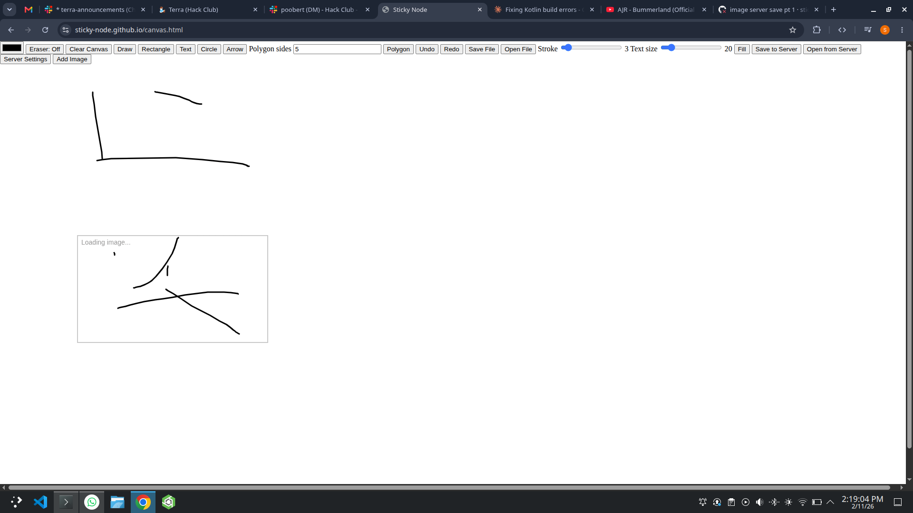

## Preview



## Highlights

- **Draw naturally** with adjustable stroke width, stroke color, and background color
- **Build diagrams** with rectangles, circles, regular polygons, and arrows
- **Add context** with multi-line text and adjustable font size
- **Edit in place** by moving any drawn item after creating it
- **Work safely** with object-level erasing and 100-step undo / redo
- **Keep ownership** with local autosave and `.sticky.json` export/import

## Quick start

### Use the hosted app

Open the deployed app in a modern browser: **[sticky-node.github.io](https://sticky-node.github.io/)**

### Run locally

You need JDK 17 or newer. The Gradle wrapper handles the rest.


```bash
# Start the development server
./gradlew jsBrowserDevelopmentRun
```

Then open the local URL printed by Gradle.

To create a production bundle:

```bash
# Build for production
./gradlew jsBrowserDistribution
```

The production output is written to `build/dist/js/productionExecutable`.

## Tools

| Tool | How it works |
| --- | --- |
| Draw | Click and drag to draw. Clicking an existing stroke picks it up and moves it instead. |
| Rectangle / Circle / Polygon / Arrow | Click and drag to size a new shape. Click an existing shape of the same type to move it. For polygons, set the number of sides (3 or more) before clicking Polygon. |
| Text | Click empty space to place a text box, then press Enter to commit (Shift+Enter for a new line, Esc to cancel). Drag existing text to move it, and right-click it to edit. |
| Eraser | Toggle on, then click or drag over items to remove them. |
| Undo / Redo | Buttons, or Ctrl/Cmd+Z and Ctrl/Cmd+Shift+Z (or Ctrl/Cmd+Y). |
| Stroke / Background color | Use the two color swatches in the toolbar. Background color changes are included in autosaves and exported files. |
| Save File / Open File | Export or import the drawing as JSON. Uses the File System Access API where available, with a normal download as the fallback. |
| Clear Canvas | Removes everything, including the autosaved copy. |

## Storage and files

- **Autosave:** the current drawing is kept in your browser's `localStorage` and restored when you return.
- **Export:** save a drawing as a `.sticky.json` file to back it up or share it.
- **Import:** open a previously exported `.sticky.json` file from the app.
- **Clear:** permanently removes the current canvas and its autosaved copy.

## Project layout

```text
src/jsMain/kotlin/stickynode/  Kotlin/JS application code
  ui/                         UI wiring split by tools, settings, documents, and shortcuts
src/jsMain/resources/          HTML and CSS resources
server side/                   Optional local server utilities
```

## License

No license has been specified yet.
